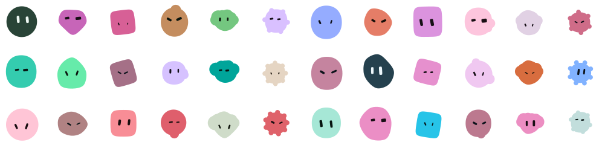

<p align="center">
  
</p>

<h1 align="center">Wobblies</h1>

<p align="center">Friendly, deterministic default avatars as SVG. The same name always gives the same avatar.</p>

<p align="center">
  <a href="https://www.npmjs.com/package/@wobblies/core"></a>
  <a href="https://github.com/josiqq/wobblies/actions/workflows/ci.yml"></a>
  <a href="https://bundlejs.com/?q=@wobblies/core"></a>
  <a href="./LICENSE"></a>
</p>


## Why

- **Deterministic.** A name maps to one avatar. Output is locked by stability fixtures; during 0.x a visual change ships as a minor release flagged "Visual change", and from 1.0.0 it requires a major release.
- **Zero dependencies.** `@wobblies/core` has no runtime dependencies, never touches the DOM, and stays under 6 kB min+gzip.
- **Works everywhere.** Node, browsers, workers, edge runtimes, React (including SSR and Server Components) and React Native.
- **Robust.** `undefined`/`null` names, untrusted strings and invalid sizes never throw, and user input is always escaped in the SVG output.
- **Typed.** Ships ESM, CJS and `.d.ts`, with a reviewed public API report.

## Quick start

### Core

```sh
npm install @wobblies/core
```

```ts
import { createAvatar, toDataUri } from "@wobblies/core";

const { svg } = createAvatar("Ana");
const src = toDataUri(svg); // use in  or CSS url()
```

### React

```sh
npm install @wobblies/react
```

```tsx
import { Wobbly } from "@wobblies/react";

export function UserAvatar() {
  return <Wobbly name="Ana" size={48} />;
}
```

### React Native

```sh
# Expo
npx expo install react-native-svg
npm install @wobblies/react-native

# Bare React Native
npm install @wobblies/react-native react-native-svg && cd ios && pod install
```

```tsx
import { Wobbly } from "@wobblies/react-native";

export function UserAvatar() {
  return <Wobbly name="Ana" size={40} />;
}
```

## Packages

| Package                                             | Description                                                 | npm                                                                                                                 |
| --------------------------------------------------- | ----------------------------------------------------------- | ------------------------------------------------------------------------------------------------------------------- |
| [`@wobblies/core`](./packages/core)                 | Framework-agnostic SVG avatar generator, zero dependencies. | [](https://www.npmjs.com/package/@wobblies/core)                 |
| [`@wobblies/react`](./packages/react)               | React component rendering real `<svg>` elements.            | [](https://www.npmjs.com/package/@wobblies/react)               |
| [`@wobblies/react-native`](./packages/react-native) | React Native component built on `react-native-svg`.         | [](https://www.npmjs.com/package/@wobblies/react-native) |

All three packages are versioned together.

## Links

- [Documentation](https://josiqq.github.io/wobblies)
- [Playground](https://josiqq.github.io/wobblies/playground/)
- [Contributing](./CONTRIBUTING.md)
- [Code of Conduct](./CODE_OF_CONDUCT.md)
- [Security policy](./SECURITY.md)

## License

[MIT](./LICENSE) © josiqq
